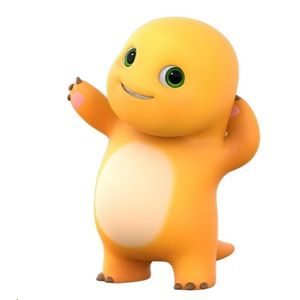
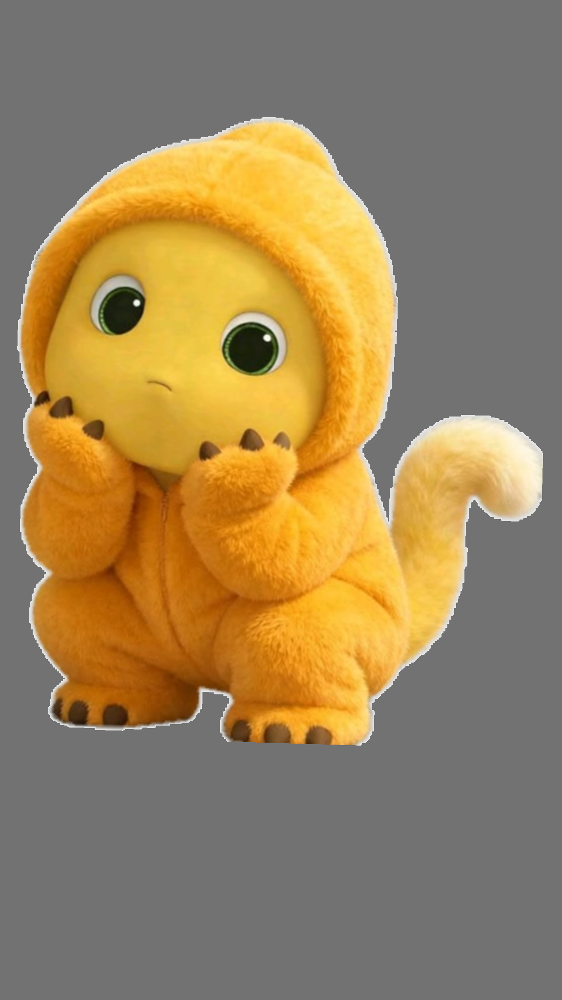
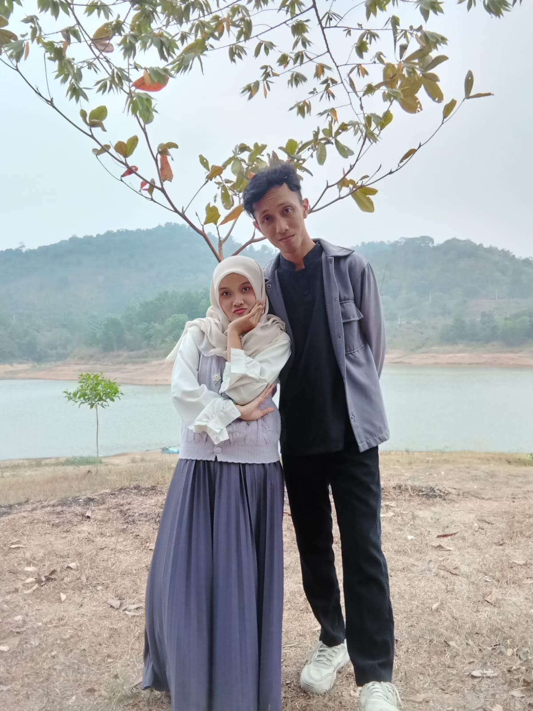
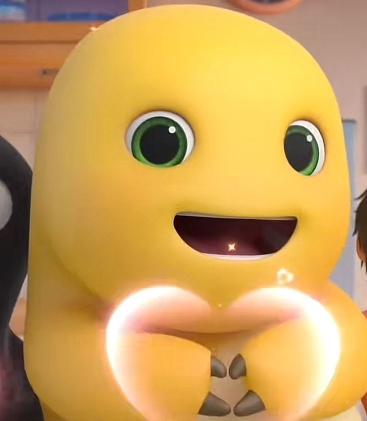
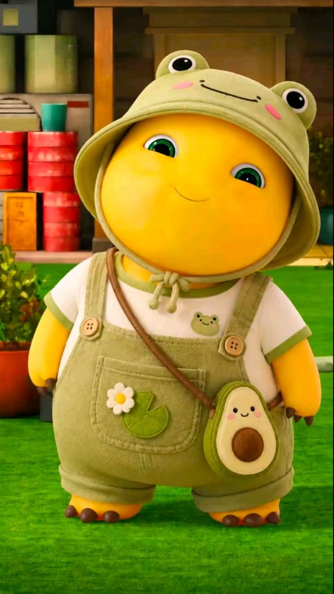
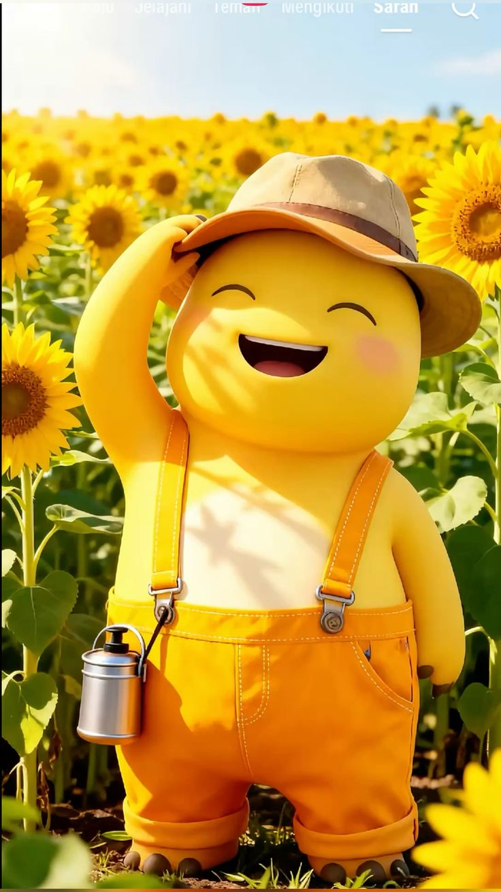

<html lang="id">
<head>
    <meta charset="UTF-8">
    <meta name="viewport" content="width=device-width, initial-scale=1.0">
    <title>Untuk Kamu ❤️</title>

    
</head>

<body>

    <!-- BACKGROUND -->
    

    

    

    <!-- MUSIK -->
    <audio id="music" loop>
        <source src="musik.mp3" type="audio/mpeg">
    </audio>

    <button class="music-btn" id="musicButton"
            onclick="toggleMusic()" aria-label="Putar atau jeda musik">
        ♪
    </button>

    <!-- CONFETTI -->
    <canvas id="confetti"></canvas>

    <!-- HALAMAN 1 -->
    <section class="page active" id="page1">
        

            
            <h1>Hai, sayanggg....</h1>
            
Aku punya sesuatu yang udah aku siapin khusus buat kamu.

            
Tapi kayaknya kamu harus klik beberapa tombol dulu deh wkwk.

            <button onclick="nextPage()">Mulai →</button>
        

    </section>

    <!-- HALAMAN 2 -->
    <section class="page" id="page2">
        

            
            <h2>Aku buat sesuatu buat kamu</h2>
            
Gak mahal sih, bukan sesuatu yang mewah juga.

            
Malah rada alay mungkin, tapi aku buatnya dengan banyak waktu dan rada malu juga sih 😅

            <button onclick="nextPage()">Buka →</button>
        

    </section>

    <!-- HALAMAN 3 -->
    <section class="page" id="page3">
        

            
            
            <h2>Ini kita.</h2>
            
Dari sekian banyak orang yang ada di dunia, aku bersyukur bisa ketemu kamu.

            <button onclick="nextPage()">Lanjut →</button>
        

    </section>

    <!-- HALAMAN 4 -->
    <section class="page" id="page4">
        

            
            <h2>Tapi tunggu...</h2>
            
Ada satu hal yang sebenernya pengen banget aku sampein hari ini.

            
Jadi... jangan di-skip yakkk 😁

            
Aku bakal marah banget kalo di-skip.

            <button onclick="nextPage()">Aku siap →</button>
        

    </section>

    <!-- HALAMAN 5 -->
    <section class="page" id="page5">
        

            
            <h1>SELAMAT ULANG TAHUN!</h1>
            <h2>Putri Aulia Fauziah 🥳🎂</h2>
            

            <button onclick="nextPage()">Masih ada lagi. Sabar yaa →</button>
        

    </section>

    <!-- HALAMAN 6 -->
    <section class="page" id="page6">
        

            
            <h2>Makasih banget, udah hadir</h2>
            
Makasih banget karna udah jadi bagian dari hidup aku.

            
Makasih banget untuk semua cerita, tawa, perhatian, kesabaran (meskipun dikit hehe), dan waktu yang udah kita lewati.

            
Aku mungkin belum sempurna, tapi aku akan selalu berusaha menjadi seseorang yang bisa membuat kamu merasa dihargai.

            <button onclick="nextPage()">Satu pesan terakhir →</button>
        

    </section>

    <!-- HALAMAN 7 -->
    <section class="page" id="page7">
        

            
            <h1>Untuk kamu.</h1>
            
Semoga di usia yang baru, semua hal baik datang satu per satu kepada kamu.

            
Semoga kamu selalu sehat, bahagia, dimudahkan dalam segala urusan, dan bisa mencapai semua hal yang kamu impikan.

            
Dan kalau boleh aku berharap, semoga aku masih bisa menjadi bagian dari banyak cerita indah dalam hidup kamu. Aamiinnn....

            <h2>Selamat ulang tahun sayang 🎂🥳</h2>
            
— dari Odi Bangun Pangestu

            <button onclick="restart()">Mulai lagi ↻</button>
        

    </section>

    

</body>
</html>
